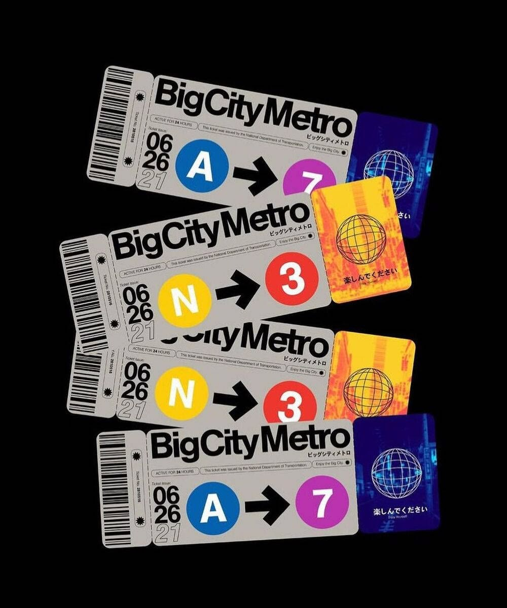
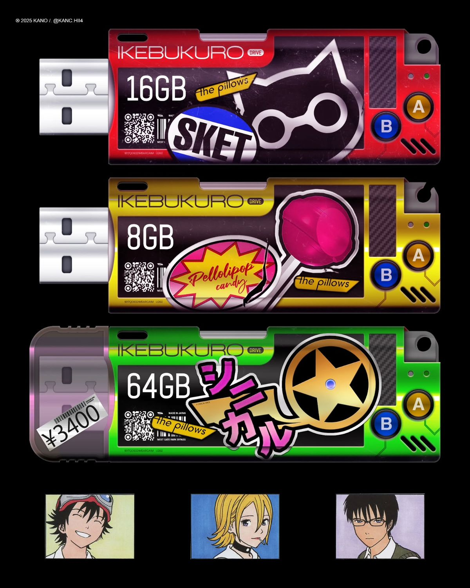

# Design Vibes

Two reference images set the visual direction.

## 1. Big City Metro tickets

- Transit-ticket aesthetic: warm grey ticket stock on pure black.
- Heavy, tight grotesk wordmark; tiny uppercase micro-copy (issuer, validity, ticket no.).
- Route badges: solid colored circles (blue, yellow, red, purple) with bold white letters/numbers, joined by a thick arrow.
- Barcode strip with a perforated stub edge; large stacked date numerals.
- Holographic card accents (wireframe globe on blue / orange-yellow gradients) with Japanese captions.

## 2. Ikebukuro Drive USB sticks

- Chunky glossy hardware, saturated candy colors (red, yellow, green) on pure black.
- Big condensed capacity numerals (16GB / 8GB / 64GB) on a dark label panel.
- Sticker-bomb details: QR codes, barcodes, price tags, brand stickers, Japanese katakana.
- Round A / B buttons, carbon-fiber texture, small LED dots.
- Small anime portrait thumbnails along the bottom edge.

## Takeaways for the UI

- Black canvas, objects that feel physical (tickets, drives, cards).
- Bold grotesk type paired with tiny technical micro-copy.
- Saturated accent colors used sparingly as badges.
- Barcode / QR / serial-number motifs; these suit the "encrypted object / key" theme well (e.g. each stored chat or file rendered as a ticket or drive).
- Subscription tiers could map to the drive capacity idea (8GB / 16GB / 64GB-style cards).
